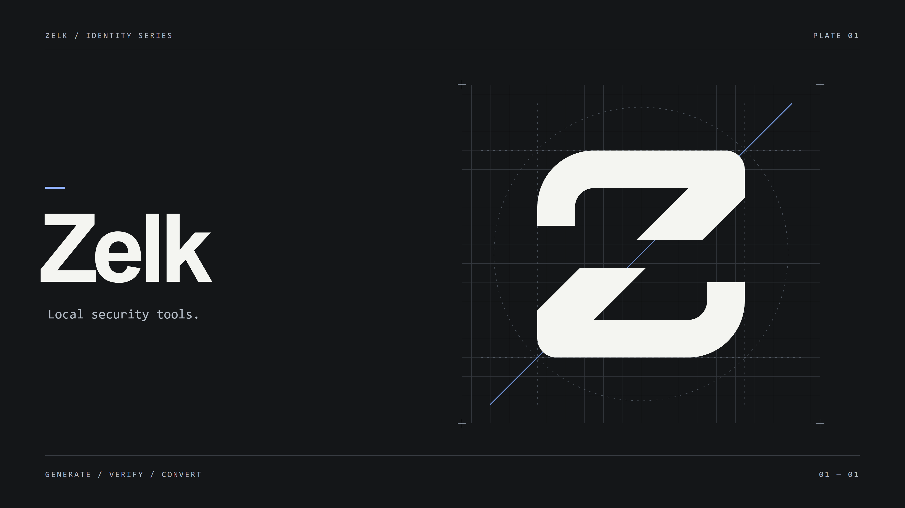

# Zelk

Zelk helps you create a password for a new account, generate a secret for an app, or check a hash. Everything runs on your device.

- **Generate** passwords, passphrases, and random tokens.
- **Verify** a password against its hash, or compare a text digest with an expected value.
- **Convert** UTF-8 text to hex or Base64 and back.

Start with the one-click password generator, or open the advanced tools for more control. No account is required, and your secrets are never sent to a server for processing.

**Website:** [zelk.dev](https://zelk.dev/)

## Tools

### Generate
- [Password generator](https://zelk.dev/generate/password)
- [Passphrase generator](https://zelk.dev/generate/passphrase)
- [Token, salt, and nonce generator](https://zelk.dev/generate/token)
- [Developer secret generator](https://zelk.dev/generate/secret)
- [UUID generator](https://zelk.dev/generate/uuid)

### Hash and authenticate
- [Hash Lab — calculate and compare digests](https://zelk.dev/crypto/hash)
- [HMAC generator](https://zelk.dev/crypto/hmac)
- [Password hashing and verification](https://zelk.dev/crypto/password-hash)

### Convert
- [Base64 and Base64URL converter](https://zelk.dev/convert/base64)
- [Hex converter](https://zelk.dev/convert/hex)
- [URL component encoder and decoder](https://zelk.dev/convert/url)

### Inspect
- [Password pattern analyzer](https://zelk.dev/inspect/password)
- [Hash format inspector](https://zelk.dev/inspect/hash)
